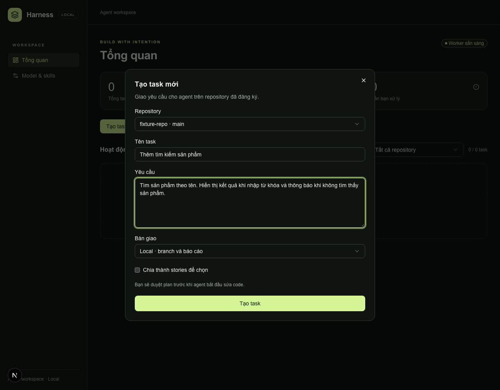
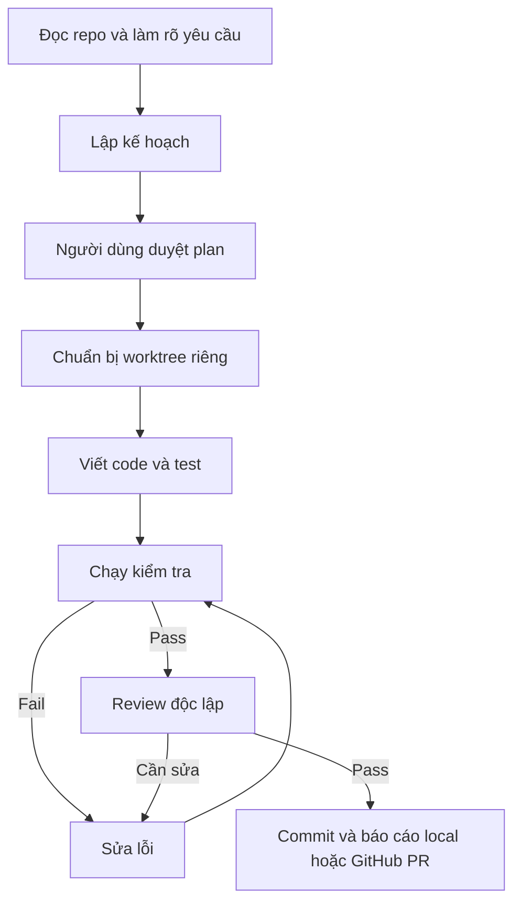

# Agent Harness

Agent Harness chạy trên máy local và dùng Codex để thực hiện task trên repo Git: viết code, chạy test, review và tạo commit hoặc GitHub PR. Mỗi task chạy trên branch và worktree riêng. Plan phải được duyệt trước khi sửa code.

## Bắt đầu

### Chạy trực tiếp trên máy

Cần cài Node.js từ phiên bản 24.18.0 đến trước phiên bản 25, npm, Git và Codex CLI hỗ trợ `app-server` cùng native subagents. Phiên bản đã chạy thử trên macOS là `codex-cli 0.159.0-alpha.12.1`.

```sh
nvm use
npm ci
codex login
npm run dev
```

Mở [http://127.0.0.1:3000](http://127.0.0.1:3000) để truy cập dashboard. Lệnh `npm run dev` khởi động cả dashboard và worker xử lý task. Nhấn `Ctrl+C` để dừng.

### Chạy bằng Docker

Cấu hình `docker-compose.yml` hiện yêu cầu Docker Desktop trên macOS, Docker Compose từ phiên bản 2.22.0 và SSH agent của Docker Desktop. Cần có file `~/.ssh/known_hosts`. Nếu kết nối Git remote qua SSH, SSH agent phải có key được cấp quyền truy cập và file này phải chứa host của remote. Thư mục chứa repo mặc định là `~/Documents/Personal`; dùng biến `HARNESS_REPOS_DIR` để đổi thư mục.

```sh
docker compose up -d --build
```

Để tự động build lại khi code thay đổi, chạy:

```sh
docker compose up --build --watch
```

Mở [http://127.0.0.1:3000](http://127.0.0.1:3000) và đăng nhập Codex. Trong Docker, đăng ký repo bằng đường dẫn `/repos/...`; ví dụ `~/Documents/Personal/my-app` trên máy tương ứng với `/repos/my-app`.

Chạy `docker compose logs -f` để xem log và `docker compose down` để dừng. Lệnh dừng vẫn giữ dữ liệu. Image có sẵn Node.js, Python, Git và GitHub CLI. Nếu repo dùng Java hoặc runtime khác, cần thêm runtime đó vào image. Cấu hình sandbox nằm trong [config/README.md](config/README.md).

## Tạo task đầu tiên



Chế độ **Duyệt quyền khi cần** yêu cầu xác nhận mỗi khi công cụ cần thêm quyền. Chế độ **Auto sau khi duyệt Plan** cho phép công cụ chạy mà không hỏi quyền; các giới hạn sandbox vẫn áp dụng. Cả hai chế độ đều yêu cầu duyệt plan trước khi chạy.

Nhấn **Bật thông báo** ở đầu workspace, rồi cấp quyền thông báo trong trình duyệt. Khi agent cần quyền thực thi, trình duyệt sẽ gửi thông báo. Nhấn vào thông báo để mở task có yêu cầu đang chờ, rồi chọn **Cho phép / Từ chối**.

Cần giữ ít nhất một tab Harness mở trong trình duyệt desktop hỗ trợ Notifications API và Web Locks. Nếu trình duyệt chặn thông báo, vẫn có thể duyệt quyền trên dashboard. Thông báo chỉ áp dụng cho yêu cầu quyền thực thi, không áp dụng cho duyệt plan.

## Một task chạy thế nào?



Nếu yêu cầu, phạm vi hoặc base remote thay đổi, plan phải được duyệt lại. Khi test hoặc review chưa đạt, Harness tiếp tục sửa và không giới hạn số vòng sửa. Task dừng khi cần thêm thông tin hoặc quyền thực thi, hết quota, gặp lỗi runtime hoặc thiếu môi trường chạy. Dashboard ghi rõ lý do dừng. Có thể pause hoặc cancel task trong quá trình chạy.

## Ai làm từng bước?

Worker điều phối các bước, chạy test và tạo commit hoặc PR. Mỗi task có một agent cha giao việc cho các subagent. Mỗi lượt AI dùng một subagent mới, chỉ nhận thông tin cần cho lượt đó, không nhận toàn bộ lịch sử của agent cha. Một subagent riêng thực hiện review với quyền chỉ đọc code.

Subagent nhận hai loại hướng dẫn: profile xác định công việc phụ trách, còn skill hướng dẫn cách thực hiện. Mỗi lượt chỉ chạy một subagent, kể cả khi nạp nhiều hướng dẫn.

| Bước        | Ai thực hiện?                            | Công việc                                         |
| ----------- | ---------------------------------------- | ------------------------------------------------- |
| `discover`  | Subagent đọc repo                        | Xác định stack, convention và lệnh kiểm tra       |
| `analyze`   | Subagent phân tích + grilling            | Làm rõ yêu cầu và câu hỏi còn thiếu               |
| `plan`      | Subagent planner + writing-plans         | Lập phạm vi sửa, tiêu chí nghiệm thu và test plan |
| `prepare`   | Worker; subagent khi có conflict         | Tạo worktree và đồng bộ base remote               |
| `implement` | Subagent theo stack + TDD                | Viết code và test trong phạm vi đã duyệt          |
| `verify`    | Runner; subagent nếu có ảnh UI được chọn | Chạy test/checks và xem ảnh UI nếu plan yêu cầu   |
| `review`    | Subagent reviewer, chỉ đọc               | Kiểm tra code và test có đáp ứng plan không       |
| `repair`    | Subagent debugger + TDD                  | Sửa lỗi test hoặc lỗi reviewer tìm thấy           |
| `deliver`   | Worker                                   | Kiểm tra lần cuối, tạo commit/báo cáo hoặc PR     |

Danh sách profile và skill cho từng bước nằm trong [agents/README.md](agents/README.md) và [skills/README.md](skills/README.md).

## Giới hạn hiện tại

- Harness chạy local và xử lý một task mỗi lần. Harness không tự merge hoặc deploy.
- Các kiểm tra bắt buộc trong plan và review phải pass trước khi bàn giao. Có thể bỏ qua test cũ ngoài phạm vi task, nhưng báo cáo phải ghi rõ phần đã bỏ qua.
- Dữ liệu được lưu trong `.harness/` khi chạy trực tiếp, hoặc trong volumes khi dùng Docker.

## Khi sửa dự án này

Các lệnh để chạy test, kiểm tra kiểu dữ liệu và build:

```sh
npm test
npm run typecheck
npm run build
npx playwright install chromium
npm run test:e2e
```

Test E2E mô phỏng agent và dùng Git, test runner, browser thật. Kết quả E2E chưa xác nhận toàn bộ luồng chạy được với model và GitHub thật. Phạm vi đã kiểm chứng được ghi trong các tài liệu sau:

- [Thiết kế đã duyệt](docs/superpowers/specs/2026-09-23-agent-harness-design.md): yêu cầu và cách dự án hoạt động.
- [Agent profiles](agents/README.md) và [skills](skills/README.md): các hướng dẫn agent đang dùng và cách cập nhật.
- [Runtime agent cha và subagent](docs/verification/2026-10-05-parent-subagents.md): kết quả thử native subagents và những giới hạn còn lại.
- [Prepare và kiểm chứng UI](docs/verification/2026-10-05-prepare-ui-verify.md): đồng bộ base và kiểm tra ảnh giao diện.
- [Kiểm chứng MVP/Docker](docs/verification.md): kết quả và phần chưa xác nhận.

[Kiến trúc backend](docs/backend-architecture.md) mô tả application services, worker, adapters và giao tiếp giữa agent cha với subagent.

Luồng chạy task nằm ở [pipeline/runtime.ts](src/application/pipeline/runtime.ts) và [pipeline/stages.ts](src/application/pipeline/stages.ts). Code chọn profile và skill nằm ở [context/agents.ts](src/infrastructure/context/agents.ts) và [context/skills.ts](src/infrastructure/context/skills.ts).

## Chia feature thành stories

Khi tạo task, bật **Chia thành stories để chọn** để planner đề xuất các story. Mỗi story có kết quả cần đạt, tiêu chí nghiệm thu, dependency và point (1, 2, 3, 5, 8). Point thể hiện độ phức tạp và mức độ bất định, không quy đổi sang token hoặc phần trăm quota. Cần chọn story cùng toàn bộ story mà nó phụ thuộc, rồi duyệt plan.

- **PR riêng từng story:** mỗi story có task và branch riêng, dùng cùng lựa chọn bàn giao qua GitHub hoặc local của feature. Story phụ thuộc chỉ chạy khi commit của story trước đã được tích hợp vào nhánh đích. Harness không tự merge. Nếu base thay đổi, plan mới của task con phải được duyệt. Nếu không thể xác nhận việc tích hợp sau squash hoặc rebase qua quan hệ tổ tiên của commit (ancestry), task dừng để người dùng xử lý.
- **Một PR cho toàn feature:** các story dùng chung branch. Mỗi story phải qua test và review trước khi lưu commit hoặc checkpoint. Sau story cuối, Harness kiểm tra lại toàn bộ phạm vi đã chọn trên snapshot cuối trước khi tạo PR hoặc bàn giao local.

Mặc định, Harness dừng sau mỗi story; nhấn **Tiếp tục** để chạy story tiếp theo. Khi bật **Tự tiếp tục các stories đã chọn**, Harness vẫn kiểm tra dependency, quyền phê duyệt, test và review trước khi tiếp tục. Trang feature hiển thị tiến độ, checkpoint và liên kết đến task con hoặc PR. Khi pause hoặc hết quota, Harness giữ checkpoint đã hoàn thành. Resume tiếp tục từ checkpoint và không chạy lại story đã hoàn thành. Chia feature thành stories giúp giảm phần việc dang dở, nhưng quota vẫn có thể hết khi một story chưa hoàn thành.

[Thiết kế story delivery](docs/superpowers/specs/2026-10-06-story-delivery-design.md) · [Kế hoạch triển khai](docs/superpowers/plans/2026-10-06-story-delivery.md).

## Kiểm tra code

```sh
npm run lint          # ESLint, không chấp nhận warning
npm run lint:fix      # Tự sửa các lỗi ESLint hỗ trợ
npm run format       # Format bằng Prettier
npm run format:check # Kiểm tra format
npm run typecheck
```
