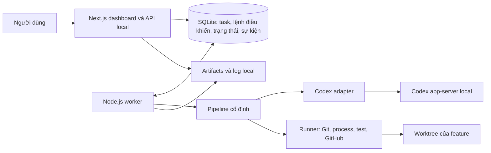

# Agent Harness: thiết kế MVP local

Ngày: 2026-09-23
Trạng thái: thiết kế đã duyệt ngày 2026-09-23; bổ sung theo yêu cầu người dùng ngày 2026-10-03: agent GitHub theo stage, effort cố định trong code (plan high, còn lại medium), model tiết kiệm ngoài planning và worktree riêng mỗi feature.

Bổ sung đã duyệt ngày 2026-10-05: [một agent cha và các subagent theo stage](2026-10-05-parent-subagents-design.md) thay cơ chế phiên AI độc lập. Mỗi task có một parent thread (`gpt-6-luna/medium`); mỗi attempt AI tạo một con native mới (`fork_turns="none"`). Reviewer là con riêng với quyền chỉ đọc. Worker quản lý các điều kiện chuyển bước, quyền thực thi, test verdict và delivery. Với các bước tạo phiên reviewer, worker cấp stage cho cha để spawn đúng một con reviewer; skill của con không tự điều phối thêm. Phạm vi đã kiểm chứng được ghi trong [bằng chứng và giới hạn runtime](../../verification/2026-10-05-parent-subagents.md).

## 1. Mục tiêu và phạm vi

Agent Harness nhận task trên repo có sẵn, làm rõ requirement và trình plan để duyệt. Sau approval, Harness tự viết code, viết test, review, sửa lỗi và bàn giao PR. Mục tiêu là giảm thời gian người dùng phải can thiệp mà vẫn đáp ứng tiêu chí nghiệm thu.

Các quyết định sản phẩm đã chốt:

- Dashboard dùng Next.js, chạy local; một task thực thi tại một thời điểm.
- Nhận repo Git thuộc bất kỳ ngôn ngữ/framework nào. Không giới hạn repo đích ở Next.js.
- Tự đọc repo để giải quyết task người dùng giao; không tự tìm việc để làm.
- Pipeline có stage cố định, không có trình kéo thả workflow trong MVP.
- Dùng Codex làm coding agent, ưu tiên đăng nhập ChatGPT với quyền truy cập sẵn có.
- Người dùng duyệt requirement, plan, tiêu chí nghiệm thu và phạm vi test trước khi code.
- Mỗi feature/task có branch và worktree riêng; reviewer có phiên Codex riêng.
- Người dùng có thể chọn model theo stage; effort cố định trong code: plan/replan high, các stage AI khác medium. Mặc định plan dùng gpt-6-astra, còn lại gpt-6-luna. Không fallback khi model/effort không khả dụng.
- Stage AI dùng skill bundle rõ ràng và baseline hành vi từ `AGENTS.md`; runtime lưu nguồn/phiên bản đã nạp.
- Viết test cho tính năng mới và bug đang sửa; có thể bỏ qua test cũ ngoài phạm vi feature.
- Theo yêu cầu đã duyệt ngày 2026-10-07, không giới hạn số vòng repair tự động. Giữ bộ đếm để theo dõi lịch sử; vẫn dừng khi cần input/approval, lỗi runtime/môi trường hoặc người dùng pause/cancel.
- Tạo GitHub PR khi đạt điều kiện; bàn giao local nếu remote không được hỗ trợ hoặc không có remote.
- Không tự merge task vào base, deploy hoặc xóa worktree. Theo cập nhật 2026-10-05, prepare được phép đồng bộ base remote vào worktree riêng.

Các lựa chọn kỹ thuật trong spec là đề xuất triển khai các quyết định sản phẩm đã chốt và cần được review cùng spec.

## 2. Kiến trúc đề xuất

- Web dùng Next.js và TypeScript để nhập task, duyệt plan, xem timeline/test/review và điều khiển pause/resume/cancel. API lưu yêu cầu điều khiển; agent chạy độc lập với vòng đời HTTP request.
- Worker là tiến trình Node.js và TypeScript độc lập với web. Worker đọc yêu cầu từ database, chiếm quyền chạy một task, thực thi pipeline, ghi sự kiện và kết quả.
- SQLite lưu dữ liệu có cấu trúc; filesystem lưu báo cáo, log lớn và ảnh/trace E2E. Cách lưu này phục vụ một người dùng local mà không cần dịch vụ database riêng.
- Codex adapter giao tiếp với app-server để lấy danh sách model, bắt đầu/tiếp tục/ngắt lượt, nhận sự kiện và chuyển yêu cầu quyền thực thi sang dashboard. Protocol Codex được tách khỏi logic chuyển trạng thái.
- Runner thực thi các lệnh đã xác định cho repo, thu exit code và báo cáo thực tế. Runner quyết định kết quả test dựa trên bằng chứng, không dựa trên lời khẳng định của model.
- UI đọc snapshot và sự kiện có sequence tăng dần. MVP dùng polling theo cursor; đóng tab không dừng worker.

Pipeline cố định quy định khi nào được code, retry, chờ người dùng hoặc tạo PR, giúp kiểm tra từng điều kiện chuyển bước. MVP không giao toàn quyền chọn bước cho agent và không có workflow engine tùy biến.

## 3. Repo discovery và môi trường

Người dùng nhập hoặc chọn đường dẫn local đến repo Git, rồi cấu hình base branch và remote. Hệ thống kiểm tra đường dẫn và branch tồn tại trước khi nhận task.

Bổ sung đã duyệt ngày 2026-10-09: workspace có Quản lý repository và thao tác Gỡ và xoá lịch sử cần xác nhận. Thao tác này xoá đăng ký repository, toàn bộ task (kể cả task con), sự kiện, lệnh điều khiển, profile, plan, attempt và các bản ghi/báo cáo liên quan trong Harness. Thư mục Git gốc và worktree được giữ nguyên. Hệ thống chặn thao tác khi còn task, attempt hoặc lệnh đang xử lý, hoặc chưa xác nhận tiến trình cũ đã dừng. Dữ liệu trong database được xoá bằng một transaction; UI cập nhật lại lựa chọn repository. Bộ lọc Hoạt động gần đây mặc định là Tất cả trạng thái.

Discovery đọc hướng dẫn repo, manifest, lockfile, cấu trúc source, scripts, CI và cấu hình test. Kết quả là Repo Profile có:

- Repo root, commit đã đọc, các ngôn ngữ và khu vực chức năng.
- Lệnh setup/build/test, thư mục chạy lệnh, prerequisites và đường dẫn file làm căn cứ.
- Những thông tin chưa xác định được, tách rõ khỏi cấu hình chạy đã có căn cứ.

Harness lưu bản đồ tổng quan gắn với revision; mỗi task đọc sâu vùng liên quan, không đưa toàn bộ repo vào mỗi prompt. Khi branch hoặc commit thay đổi, Harness kiểm tra lại thông tin bị ảnh hưởng.

Harness hỗ trợ đa ngôn ngữ bằng command specification, gồm executable, arguments, cwd, biến môi trường được cho phép, timeout và đường dẫn báo cáo. Repo không bắt buộc dùng npm hoặc cùng một test runner. Khi chưa xác định được command có căn cứ, Harness đề xuất command để người dùng xác nhận trong plan.

Nếu máy thiếu runtime, database hoặc service, task chờ thiết lập môi trường. Harness có thể cài project dependencies trong môi trường riêng theo plan. Việc cài runtime hoặc thay đổi cấu hình hệ thống cần người dùng duyệt. Harness không tự thực thi script chỉ để đọc cấu trúc repo.

Không đọc nội dung secret vào context hay log. Credentials dùng cho môi trường test được truyền riêng khi cần, không ghi vào tài liệu kế hoạch.

## 4. Requirement và kế hoạch thực thi task

Stage phân tích đối chiếu task với Repo Profile và hỏi người dùng về các quyết định nghiệp vụ không thể suy ra từ code. Khi requirement chưa rõ, task chờ câu trả lời; agent không tự chọn hành vi sản phẩm.

Plan có phiên bản, bao gồm:

1. Mục tiêu và những gì ngoài phạm vi.
2. Tiêu chí nghiệm thu có ID ổn định.
3. Khu vực code dự kiến thay đổi, dependencies mới và yêu cầu môi trường.
4. Branch nguồn, commit nguồn và branch đích PR.
5. Test plan: từng kiểm tra, loại unit/integration/E2E, command, prerequisites, tiêu chí nghiệm thu được kiểm chứng.
6. Model/effort dự kiến cho từng stage AI; repair không có giới hạn số vòng.

Plan phải đủ chi tiết để model tầm trung implement mà không cần thiết kế lại. Plan nêu thứ tự bước và dependency, file/module cần thay đổi, interface và dữ liệu vào/ra khi có, hành vi lỗi liên quan, test cần viết, command kiểm tra và kết quả mong đợi. Nếu một mục không áp dụng cho bước đang xét, plan phải nêu lý do, không tạo thêm abstraction để điền đủ mục. Các quyết định sản phẩm chưa rõ phải được làm rõ trước approval.

Approval gắn với phiên bản plan và phạm vi công việc. Khi requirement, tiêu chí nghiệm thu hoặc dependency thay đổi, hoặc phạm vi mở rộng, approval cũ mất hiệu lực. Harness trình phần thay đổi và chờ duyệt lại. Agent tự quyết chi tiết triển khai trong phạm vi đã duyệt.

## 5. Pipeline và trạng thái

Stage xác định công việc đang thực hiện; status xác định công việc đang chạy hay phải chờ. Hai trường được lưu riêng để không phải tạo thêm trạng thái cho mỗi cặp công việc và nguyên nhân gián đoạn.

Stages: `discover`, `analyze`, `plan`, `prepare`, `implement`, `verify`, `review`, `repair`, `deliver`.

Statuses: `queued`, `running`, `waiting_input`, `waiting_approval`, `blocked`, `paused`, `interrupted`, `completed`, `cancelled`, `failed`.

Mỗi trạng thái chờ có reason và hành động cần thiết; ví dụ `quota`, `environment`, `model_unavailable`, `test_failure`, `delivery_error`.

| Stage     | Đầu ra và điều kiện chuyển tiếp                                                                                                                                                                    |
| --------- | -------------------------------------------------------------------------------------------------------------------------------------------------------------------------------------------------- |
| discover  | Repo Profile và kiểm tra khả năng thực thi → analyze                                                                                                                                               |
| analyze   | Requirement đủ rõ; thiếu thông tin → waiting_input; đủ → plan                                                                                                                                      |
| plan      | Plan có phiên bản → waiting_approval; được duyệt → prepare                                                                                                                                         |
| prepare   | Tạo/xác minh worktree, fetch base từ remote và merge trong worktree riêng; conflict dùng AI giới hạn theo file. Base đổi → discover/plan và duyệt lại; baseline giữ nguyên → implement hoặc repair |
| implement | Code và test cho tính năng mới/bug → verify                                                                                                                                                        |
| verify    | Runner chạy checks; UI task có screenshot được chọn thì thêm một lượt AI đọc ảnh. Tất cả bắt buộc pass → review; lỗi hành vi/giao diện → repair; thiếu evidence/môi trường → blocked               |
| review    | Không còn finding bắt buộc sửa, đủ bằng chứng → deliver; có finding → repair                                                                                                                       |
| repair    | Sửa theo lỗi test/review, tăng repair round → verify; thay phạm vi → plan                                                                                                                          |
| deliver   | Kiểm tra evidence còn hiệu lực, commit/push/tạo PR hoặc xuất bàn giao local → completed                                                                                                            |

`paused`, `interrupted`, `blocked` giữ stage hiện tại và lần chạy cuối. Resume phải qua bước đối chiếu thực tế trước khi xác định stage tiếp tục. `failed` dành cho lỗi không thể phục hồi của lần chạy, không dùng thay cho chờ hạn mức/môi trường.

Khi quay lại plan giữa vòng sửa, Harness giữ worktree, branch và repair count. Sau khi plan mới được duyệt, task tiếp tục phần việc đang sửa, không bắt đầu lại implementation từ đầu. Repair count chỉ dùng để theo dõi lịch sử.

Mỗi task có nhiều Stage Attempt. Một attempt lưu đầu vào, model/effort thực dùng, phiên Codex, thời điểm, status, revision và output. Sự kiện cũ không được sửa để che một attempt thất bại.

## 6. Model và context

Các stage `discover`, `analyze`, `plan`, `implement`, `review`, `repair` có cấu hình model/effort riêng. Implement và repair bao gồm viết test. Verify chạy command và chỉ gọi model review khi có ảnh UI được chọn. Prepare dùng công cụ Git và chỉ gọi model repair khi có conflict. Hai lượt AI tùy điều kiện này dùng model của review hoặc repair, không có lựa chọn model riêng. Deliver không gọi model.

Chính sách theo yêu cầu ngày 2026-10-03, thay thế lựa chọn effort trên UI:

| Stage                                        | Model mặc định                             | Effort                   |
| -------------------------------------------- | ------------------------------------------ | ------------------------ |
| plan, gồm replan                             | gpt-6-astra                                | high                     |
| discover, analyze, implement, review, repair | gpt-6-luna                                 | medium                   |
| prepare                                      | Worker; conflict dùng model repair đã chọn | medium khi có conflict   |
| verify                                       | Runner; ảnh UI dùng model review đã chọn   | medium khi có screenshot |
| deliver                                      | Worker, không gọi model                    | Không áp dụng            |

Policy nằm trong `src/core/model-policy.ts`; muốn thay effort phải sửa code. UI cho đổi model và hiển thị effort cố định. API chuẩn hóa effort khi lưu settings, tạo task và áp dụng model vào task. Runtime và attempt log dùng effort của policy. Harness giữ lựa chọn model cũ của task, lịch sử attempt và context snapshot đã ghi. Nếu cặp model/effort không khả dụng, task chuyển sang blocked, không tự fallback. Cấu hình model tiết kiệm không cam kết mức quota hoặc số tiền cụ thể.

- Thứ tự model: snapshot task → cấu hình hệ thống → mặc định trong code.
- Khi tạo task, sao chép cấu hình mặc định vào task; chụp cấu hình thực dùng thành snapshot khi bắt đầu attempt. Thay setting chung không âm thầm đổi task đã tạo.
- Danh sách model và effort lấy từ runtime/tài khoản; kiểm tra cặp lựa chọn hợp lệ trước khi chạy.
- Model không khả dụng: báo và chờ người dùng chọn lại. Không tự fallback.
- Khi chuyển plan → implement, worker dùng model implement đã lưu mà không hỏi lại, theo cấu hình stage đã được cho phép. Worker không tự nâng hoặc hạ model ngoài cấu hình.
- Thay model có hiệu lực ở lượt sau. Muốn đổi ngay phải ngắt lượt đang chạy, chờ nó dừng, đối chiếu file/process rồi tiếp tục.
- Model mới nhận requirement/plan đã duyệt, diff hiện tại, finding và kết quả kiểm tra liên quan. Không phụ thuộc vào trí nhớ ngầm giữa hai phiên.
- Nếu implement phát hiện plan thiếu quyết định hoặc sai giả định quan trọng, ghi rõ vấn đề và quay lại plan với model planner đã chọn; không tự mở rộng phạm vi. Plan thay đổi phải qua approval trước khi tiếp tục, giữ nguyên branch/worktree và repair count.
- Reviewer dùng phiên riêng với quyền chỉ đọc code; output có cấu trúc gồm finding, severity, file/căn cứ, tiêu chí bị vi phạm và verdict.
- Log hiển thị model/effort thực dùng, thời gian, usage khi runtime cung cấp. Không tự quy đổi usage thành USD của subscription.

Gói được người dùng mô tả là 25 USD/tháng chưa xác định được tên gói/hạn mức cụ thể. Tích hợp cần kiểm chứng đăng nhập, catalog model và một lượt read-only với tài khoản thực trước khi xây đầy đủ pipeline. Không tự chuyển sang API tính phí.

### 6.1. Rule nền và skill theo stage

Nguồn rule nền là [AGENTS.md](../../../AGENTS.md), mục 1 đến 6: suy nghĩ trước khi code, đơn giản, thay đổi có mục tiêu, thành công có bằng chứng và trả lời tiếng Việt. Mục 7 chỉ phục vụ phát triển chính workspace harness, không truyền sang repo khác.

Harness đọc thêm `AGENTS.md` của repo đích và các hướng dẫn trong phạm vi thư mục liên quan. Nếu repo chỉ có `CLAUDE.md`, có thể dùng nội dung đó làm hướng dẫn dự án và ghi rõ nguồn. Không ghi đè những file này để cài rule của harness.

Rule `rules/lighthouse-performance.md` chỉ được nạp khi task liên quan Liquid/Shopify theme/Core Web Vitals của theme. Workspace hiện chưa có nội dung file này. Task không liên quan tiếp tục bình thường. Nếu task cần rule mà file chưa có, Harness hỏi người dùng cung cấp nội dung, không tự viết thay.

Registry skill được triển khai trong `src/context/skills.ts`; mapping agent profile nằm trong `src/context/agents.ts`. Theo yêu cầu cập nhật ngày 2026-10-04, worker nạp skills và profiles đóng gói trong repo (`skills/`, `agents/`), rồi lưu snapshot nội dung và nguồn theo task. Cấu hình Skill roots được bỏ; Harness không phụ thuộc plugin cài trên máy. Task đã có snapshot giữ nguyên nội dung.

| Stage                       | Skill/bộ hướng dẫn mặc định                                                                                                | Trách nhiệm và kết quả                                                                                                                         |
| --------------------------- | -------------------------------------------------------------------------------------------------------------------------- | ---------------------------------------------------------------------------------------------------------------------------------------------- |
| discover                    | Hướng dẫn Repo Profile riêng của harness; chưa có file skill độc lập                                                       | Đọc code/manifest/CI, trả profile có căn cứ; không sửa repo. Đây là contract trong mục 3, không giả định có skill Superpowers chuyên discovery |
| analyze                     | `mattpocock-skills:grilling`                                                                                               | Hỏi các quyết định chưa rõ theo quan hệ phụ thuộc, đưa đề xuất và chờ câu trả lời; trả requirement/acceptance criteria                         |
| analyze: nhánh thiết kế mới | `superpowers:brainstorming`, khi task cần thiết kế kiến trúc/UI/hành vi chưa chốt                                          | Khảo sát lựa chọn và đánh đổi. Dùng chung luồng hỏi/approval của harness, không mở thêm một vòng phỏng vấn trùng lặp                           |
| plan                        | `superpowers:writing-plans`                                                                                                | Kế hoạch có bước thực hiện, nơi thay đổi và điều kiện kiểm chứng; đầu ra gắn với PlanVersion                                                   |
| prepare                     | Worker thực thi Git/môi trường                                                                                             | Không nạp skill điều phối để agent tự tạo thêm worktree. Quyền và side effect thuộc worker                                                     |
| implement                   | `superpowers:test-driven-development` + rule mục tiêu/đơn giản/thay đổi có mục tiêu từ AGENTS.md                           | Red → green cho feature/bug; triển khai tối thiểu theo plan đã duyệt                                                                           |
| verify                      | Runner + nguyên tắc `superpowers:verification-before-completion`                                                           | Runner là nguồn bằng chứng; chỉ báo pass khi command/report xác nhận. Không cần thêm lượt AI chỉ để gọi lại test                               |
| review                      | `superpowers:requesting-code-review` cho bước chuẩn bị; `requesting-code-review/code-reviewer.md` cho phiên reviewer riêng | Worker tạo review package gồm plan, diff/revision và test evidence; reviewer chỉ đọc, trả finding có cấu trúc                                  |
| repair: nhận review         | `superpowers:receiving-code-review`                                                                                        | Kiểm tra tính đúng đắn của finding; có thể phản biện bằng căn cứ, không sửa máy móc                                                            |
| repair: chẩn đoán và sửa    | `superpowers:systematic-debugging` → `superpowers:test-driven-development` → `superpowers:verification-before-completion`  | Tái hiện → thu bằng chứng → xác định nguyên nhân → kiểm chứng giả thuyết → test hồi quy → sửa tối thiểu → xác minh                             |
| deliver                     | Worker + nguyên tắc `superpowers:verification-before-completion`                                                           | Đối chiếu gate và evidence của snapshot cuối, tạo PR hoặc bàn giao local; không thêm một phiên AI để tự quyết merge                            |

`systematic-debugging` cũng kích hoạt ngay khi gặp bug/test failure/unexpected behavior trong analyze hoặc implement. Lỗi có sẵn ngoài phạm vi chỉ được ghi nhận, trừ khi nó chặn kiểm chứng feature. Chưa rõ root cause thì thu thêm bằng chứng hoặc hỏi, không nối tiếp các bản vá phỏng đoán.

Khi dùng TDD, failure dự kiến ở bước red không tự chuyển pipeline sang repair và không tăng bộ đếm vòng sửa. Bộ đếm chỉ tăng khi worker mở attempt repair sau một lần verify hoặc review không đạt. Trong repair, agent ghi lại giả thuyết và các lần sửa thử, rồi điều tra nguyên nhân bằng bằng chứng. Task không dừng chỉ vì đã chạy ba vòng repair; nếu còn thiếu quyết định cần thiết, agent vẫn phải hỏi lại.

### 6.2. Phạm vi áp dụng và giải quyết xung đột

Worker giữ quyền chuyển trạng thái, cấp quyền công cụ, tạo phiên reviewer, quản lý branch và đếm retry. Skill là hướng dẫn thực hiện trong stage, không được tự thay những cơ chế đó.

Mỗi bundle ghi rõ cách tích hợp với Harness. File trong plugin cache được giữ nguyên:

- Yêu cầu trực tiếp của người dùng về phạm vi test được ưu tiên hơn yêu cầu chạy toàn bộ suite trong skill TDD. Red/green và verification áp dụng cho Test Plan của feature; báo cáo ghi rõ legacy test đã bỏ qua.
- Yêu cầu hỏi hoặc duyệt từ skill được chuyển thành `waiting_input` hoặc `waiting_approval` trên dashboard. Một PlanVersion đã duyệt không cần thêm cổng duyệt thứ hai; thay phạm vi vẫn phải duyệt lại.
- Worker tạo reviewer độc lập và dùng model đã chọn. Skill không được tự spawn reviewer trùng, chọn model mạnh hơn, merge hoặc xóa worktree.
- Phản biện review được lưu kèm bằng chứng. Finding bắt buộc sửa vẫn chưa được giải quyết khi còn tranh luận. Reviewer đánh giá lại; nếu vẫn bất đồng, Harness hỏi người dùng trong giới hạn vòng lặp.
- Agent chỉ sửa trong worktree của task và áp dụng TDD cho phần đang thay đổi. Agent không xóa hoặc rewrite code sẵn có chỉ vì code đó chưa được viết test-first.
- Skill có thể sinh báo cáo Markdown. Adapter phải chuẩn hóa và kiểm tra schema trước khi worker dùng output; lời tự nhận "done" không trực tiếp đổi status thành completed.

Không nạp tất cả Superpowers vào mỗi stage. `using-superpowers`, `executing-plans`, `subagent-driven-development`, `using-git-worktrees` và `finishing-a-development-branch` không phải bundle mặc định của runtime này vì chúng có thêm quy trình điều phối đã do worker sở hữu. Đây là quyết định về harness đang thiết kế, không thay đổi những skill mà agent phát triển harness phải tuân theo trong phiên hiện tại.

Hướng dẫn truyền cho agent có thứ tự ưu tiên: ràng buộc platform, yêu cầu người dùng và plan đã duyệt, baseline kết hợp rule repo theo phạm vi, rồi đến skill. Rule repo cụ thể hóa conventions, không được tự đổi approval, quyền công cụ hoặc giới hạn của worker. Nếu có xung đột chưa được người dùng quyết định, agent ghi rõ nguồn và hỏi; không tự bỏ qua rule.

### 6.3. Cách nạp và truy vết

- MVP dùng mapping stage cố định trong cấu hình được quản lý của harness. Chưa xây marketplace hoặc UI chỉnh sửa skill tùy ý.
- Registry ánh xạ ID skill sang nguồn, phiên bản plugin, đường dẫn thực và các tài liệu phụ cần thiết. Bản nguồn đã khảo sát: Superpowers `6.4.1`, Matt Pocock `1.2.3`.
- Resolve nội dung thực trên máy khi bắt đầu chạy; không hard-code đường dẫn cache cá nhân vào sản phẩm. Skill bắt buộc bị thiếu → blocked với lý do `skill_unavailable`.
- Lưu snapshot/hash nội dung rule, skill, tài liệu phụ đã nạp và ghi chú tích hợp trong StageAttempt. Chỉ nạp rule có trigger phù hợp; không gắn tất cả tài liệu vào mọi prompt.
- Khi plugin thay đổi giữa task, dùng bundle snapshot đã chốt. Người dùng chủ động áp dụng bản mới thì tạo attempt mới có provenance mới; không trộn hai bản trong một lượt.
- Khi resume/đổi model, truyền lại đúng rule, skill bundle và context nghiệp vụ của stage; model mới không được mất các ràng buộc này.
- Nhánh review dùng template đã nạp như tài liệu phụ của skill, không báo template đó là một skill độc lập.

## 7. Branch, worktree và revision

- Một task tương ứng một feature hoặc bug nhỏ. Task có nhiều feature độc lập phải được chia trước khi duyệt plan.
- Mặc định tạo branch `codex/<task-id>-<slug>` từ commit đã chốt của base branch. Tên va chạm phải được xử lý mà không chiếm branch của task khác.
- Cho phép branch nguồn là feature khác; lưu dependency và chọn branch đích PR phù hợp. Không tự rebase. Theo cập nhật 2026-10-05, prepare được phép merge base remote đã fetch vào worktree của task; không merge ngược task vào base.
- Mỗi task có worktree riêng. Không checkout branch khác trong working directory đang dùng của người dùng; không tự mang thay đổi chưa commit từ đó sang task.
- Discovery và plan phải gắn với revision nguồn. Nếu source thay đổi trước prepare, đọc lại phần bị ảnh hưởng và xin duyệt lại khi plan phải thay đổi.
- Resume và mọi vòng sửa giữ nguyên branch/worktree. Reviewer đọc cùng snapshot nhưng không ghi vào đó.
- Kết quả test/review gắn với snapshot fingerprint của source và cấu hình liên quan, kể cả file mới chưa commit. Bất kỳ thay đổi code sau kiểm tra làm evidence tương ứng hết hiệu lực.
- Worktree tách Git state, không được coi là sandbox bảo mật. Quyền chạy agent/process vẫn do policy thực thi giới hạn.

## 8. Chính sách test và review

Theo chính sách đã chốt, task chỉ bắt buộc kiểm chứng tính năng hoặc bug đang xử lý. Có thể bỏ qua test cũ ngoài phạm vi; toàn bộ legacy suite không bắt buộc phải pass.

- Viết test mới cho feature mới và test hồi quy cho bug đang sửa. Không bổ sung coverage hàng loạt cho code cũ.
- Test cũ trực tiếp kiểm chứng feature hiện tại có thể được đưa vào Test Plan; legacy test ngoài phạm vi được ghi rõ là không chạy.
- Unit/integration/E2E là các khả năng của harness. Mỗi task chọn loại test cần thiết trong plan, không bắt mọi thay đổi phải có cả ba.
- Nếu thiếu test tooling, đưa setup tối thiểu và dependencies vào plan đã duyệt.
- Kết quả phân biệt `passed`, `failed`, `blocked`, `skipped`, `not_applicable`. Bỏ qua test không được chuyển thành pass.
- Test bắt buộc của feature phải pass. Không tự bỏ một test bắt buộc sau khi thấy fail; thay phạm vi kiểm tra cần duyệt plan mới và phải lưu lý do.
- Nếu test không thể tách khỏi lỗi cũ, trước hết đề xuất cách chọn phạm vi phù hợp. Nếu lỗi cũ vẫn ngăn chứng minh feature đúng, báo blocked thay vì tuyên bố thành công.
- Unit/integration có thể mock theo plan. E2E chạy luồng đã duyệt trong môi trường test; thiếu account/service/credentials thì blocked, không tự thay bằng mock.
- Runner ghi command, exit code, timeout, test count nếu lấy được, báo cáo và revision. Exit code 0 nhưng không có bằng chứng các test yêu cầu đã được tìm thấy/chạy không đủ để pass.
- AI không được skip/xóa assertion chỉ để làm test xanh. Reviewer kiểm tra nội dung test với tiêu chí nghiệm thu và ghi nhận mọi thay đổi test.

Reviewer chỉ yêu cầu sửa lỗi có căn cứ về requirement, tính đúng đắn, bảo mật hoặc quy ước bắt buộc của repo. Góp ý về sở thích hoặc style ngoài phạm vi không kéo dài vòng sửa. Task phải đáp ứng requirement và có kết quả runner đạt yêu cầu; test runner pass hoặc reviewer pass riêng lẻ chưa đủ để bàn giao.

## 9. Giới hạn, pause và recovery

Theo yêu cầu đã duyệt ngày 2026-10-07, verify fail hoặc review có finding cần sửa sẽ đưa task vào repair, không giới hạn số vòng. Bộ đếm tăng một lần khi worker mở attempt repair mới và không đặt lại khi đổi model, restart worker, đổi story hoặc replan. UI hiển thị `Repair N`. Task chỉ dừng khi cần input/approval, gặp vấn đề runtime/môi trường, thay đổi phạm vi, pause hoặc cancel; không phát sinh `repair_limit` mới. Task cũ đã blocked cần người dùng nhấn Tiếp tục, không tự chạy lại khi ứng dụng cập nhật.

Runtime bổ sung policy repair hiện hành sau nội dung bundle, kể cả bundle đã frozen của task cũ: không dừng hoặc hỏi lại chỉ vì ba lần sửa thất bại. Agent phải xem lại nguyên nhân và tiếp tục chẩn đoán có bằng chứng; quyết định thực sự còn thiếu và các gate của worker vẫn có hiệu lực.

Timeout mặc định được đề xuất là 30 phút cho một lượt AI và 15 phút cho một command ngắn hạn; có thể chỉnh trong cấu hình task/plan. Dịch vụ test chạy dài hạn dùng readiness timeout và vòng đời process riêng. Khi timeout, task dừng chờ xem xét, không tự retry vô hạn. Mất kết nối điều khiển chưa xác nhận tiến trình đã dừng.

- Pause ngắt lượt/lệnh đang chạy, xác nhận tiến trình đã dừng và lưu tiến độ. Cancel dừng task nhưng giữ code và artifacts.
- Worker dùng task lease và fencing token; attempt cũ không được cập nhật kết quả sau khi mất quyền sở hữu.
- Ghi intent trước side effect; ghi kết quả sau khi xác nhận. Chuyển trạng thái và append event trong cùng transaction.
- Khi khởi động lại, task đang running được đánh dấu cần reconciliation: kiểm tra phiên Codex, PID/process identity, worktree và effect đã tạo.
- Nếu không thể xác định process cũ đã dừng, không khởi chạy agent ghi file thứ hai vào cùng worktree.
- Người dùng bấm Tiếp tục sau crash hoặc hết quota; hệ thống xác nhận checkpoint và chọn bước cần chạy lại.
- Lệnh commit/push/tạo PR phải đối chiếu trạng thái thực trước retry. Không hứa exactly-once cho side effect bên ngoài.
- Đóng tab/dashboard không giết worker; tắt máy hoặc dừng worker thì task bị gián đoạn. MVP chưa cài dịch vụ hệ điều hành tự khởi động.

## 10. Điều kiện bàn giao

Được chuyển sang deliver khi:

1. Plan hiện tại được duyệt và không có scope change đang chờ.
2. Mỗi tiêu chí nghiệm thu có bằng chứng đạt yêu cầu.
3. Các kiểm tra bắt buộc của feature pass trên snapshot cuối.
4. Reviewer không còn finding bắt buộc sửa trên snapshot đó.
5. Diff cuối nằm trong phạm vi và không có thay đổi ngoài kiểm soát sau verify/review.

Deliver tạo commit chứa phần thay đổi của task, push branch và mở PR vào target đã lưu. Báo cáo gồm mục tiêu, thay đổi, tiêu chí nghiệm thu, kết quả test, legacy tests bị bỏ qua, giới hạn, finding và quan hệ feature phụ thuộc.

Nếu GitHub báo lỗi hoặc thiếu auth, task giữ trạng thái blocked tại deliver. Người dùng có thể retry hoặc chọn bàn giao local. Repo không có remote được hỗ trợ sẽ bàn giao local theo mode đã chọn. `completed` phải ghi delivery mode và PR URL hoặc đường dẫn artifact; trạng thái này không xác nhận đã merge hay deploy.

PR được đối chiếu bằng repo/head/base và task marker để tránh tạo trùng sau mất kết nối. Nếu đã có PR thì dùng lại; nếu push thành công nhưng response bị mất thì xác minh remote head trước retry. Không force-push để giải quyết xung đột ngoài ý muốn.

## 11. Dữ liệu và giao diện MVP

Các thực thể chính:

| Thực thể                    | Nội dung                                                                                                      |
| --------------------------- | ------------------------------------------------------------------------------------------------------------- |
| Repository / RepoProfile    | Path, base/remote, commit, công nghệ, command candidates và căn cứ                                            |
| Task                        | Requirement, stage/status/reason, branch/worktree, dependency, repair count, delivery mode                    |
| PlanVersion / Approval      | Phạm vi, tiêu chí, test plan, cấu hình và phiên bản được duyệt                                                |
| StageAttempt                | Phiên Codex, snapshot cấu hình/model/rule/skill và ghi chú tích hợp, input/output, thời điểm, revision, usage |
| CheckResult / ReviewFinding | Bằng chứng test, finding và vòng sửa xử lý                                                                    |
| Event / ControlCommand      | Timeline có thứ tự; lệnh pause/resume/cancel có ID chống lặp                                                  |
| SideEffect / Artifact       | Intent/result của tác động ngoài DB; đường dẫn và fingerprint báo cáo                                         |

Các màn hình gồm danh sách repo/task, tạo task, hỏi đáp và duyệt plan, chi tiết task với timeline/tests/review, cấu hình model theo stage và kết quả bàn giao. Task detail hiển thị công việc đang chạy hoặc lý do chờ, hành động cần từ người dùng và trạng thái worker. Theo yêu cầu ngày 2026-10-04, tab Diff được bỏ; người dùng review diff trên GitHub. Pipeline vẫn giữ dữ liệu diff để review và kiểm tra phạm vi thay đổi.

Web và worker chỉ lắng nghe loopback. Mutation endpoint kiểm tra origin/session local; không mở quyền thực thi local ra mạng. Credential không gửi đến browser hoặc lưu trong database/log. Repository-controlled content không được thay policy, approval hoặc giới hạn của harness.

Bổ sung đã duyệt ngày 2026-10-07: người dùng bật thông báo hệ điều hành từ workspace để nhận yêu cầu quyền thực thi khi còn ít nhất một tab Harness mở. Nhấn thông báo đưa tab lên trước, mở đúng task và yêu cầu; quyết định cấp/từ chối quyền vẫn qua dashboard và worker. Polling toàn workspace đọc các yêu cầu đang chờ của task manual đang chạy qua API có session local; không đưa command/params vào nội dung thông báo. Chống lặp giữa các tab cùng origin và khi tải lại, đóng thông báo khi yêu cầu đã xử lý/hết hiệu lực; liên kết cũ hiển thị trạng thái hiện tại. Bản đầu dùng Notifications API và Web Locks trên browser desktop hỗ trợ, không gửi yêu cầu mới khi đóng hết tab và không mở rộng sang duyệt Plan.

## 12. Kiểm chứng harness và thứ tự xây

Các lát cắt triển khai dự kiến, mỗi lát có kết quả quan sát được:

1. Kiểm chứng kết nối Codex: auth, model và lượt chạy read-only. Resolve skill/rule, nhập repo và hiển thị profile, prerequisites, model catalog.
2. Tạo task, hỏi đáp, lưu plan version và chặn sửa code trước approval.
3. Tạo branch/worktree, chạy một lượt implement, chạy test theo plan và hiển thị bằng chứng trên dashboard.
4. Thêm reviewer độc lập, finding có cấu trúc và repair count. Vô hiệu hóa evidence khi code thay đổi.
5. Kiểm chứng pause/crash/quota/resume, đối chiếu side effect, tạo GitHub PR không trùng và bàn giao local khi cần.

Đây là thứ tự xây ở mức thiết kế; implementation plan chi tiết sẽ tách thành các việc có file, dependency và cách kiểm chứng sau khi bản spec được review.

Kiểm thử chính harness gồm:

- Unit: transition guards, approval theo version, repair sau vòng thứ ba, cấu hình model và invalidation evidence.
- Model routing: plan dùng planner model, implement dùng implementer model sau approval; task override được ưu tiên; thiếu role mapping/model không khả dụng phải chờ cấu hình; lập lại plan dùng planner model và duyệt lại; cấu hình chung thay đổi không ảnh hưởng task đã tạo.
- Skill/rule integration: thiếu skill bắt buộc phải blocked; plugin update không đổi bundle giữa lượt; đổi model/resume giữ rule; rule Lighthouse chỉ nạp cho task phù hợp; yêu cầu chạy full suite trong skill không ghi đè chính sách feature-only; expected TDD red không tiêu repair round; skill không tự tạo thêm reviewer/worktree.
- Integration: SQLite transaction/lease, Codex adapter với event giả lập, Git worktree thật trong repo tạm, process exit/timeout, reconciliation GitHub qua adapter giả lập.
- E2E dashboard: tạo task → duyệt → code → verify fail → repair → review → deliver; pause/resume; thay model; thiếu runtime; quota; legacy test fail ngoài phạm vi không chặn feature; required test bị skip phải chặn.
- Live smoke có kiểm soát: một repo frontend và một repo ngôn ngữ khác, dùng runtime có trên máy và tài khoản Codex thật. Kết quả chỉ xác nhận các môi trường được thử, không tuyên bố mọi stack đều đã kiểm chứng.
- Fault injection: worker chết sau side effect nhưng trước khi ghi kết quả; mất kết nối khi agent còn chạy; hai worker tranh lease; code đổi sau verify; PR tạo xong nhưng response mất.

MVP lưu dữ liệu để đo thời gian người dùng can thiệp, số lần hỏi lại, số vòng sửa, thời gian hoàn thành và tỉ lệ task được chấp nhận mà không cần sửa tay. Chưa đặt ngưỡng cải thiện vì chưa có baseline.

## 13. Nguồn kỹ thuật

Đã kiểm tra tài liệu ngày 2026-09-23. Các thông số account/model được đọc lại từ runtime khi chạy.

- [Codex authentication](https://learn.chatgpt.com/docs/auth): đăng nhập ChatGPT cho subscription hoặc API key cho usage-based access.
- [Codex non-interactive mode](https://learn.chatgpt.com/docs/non-interactive-mode): tái dùng CLI authentication, output và cấu hình chạy script.
- [Codex app-server](https://learn.chatgpt.com/docs/app-server): model catalog, override model/effort theo lượt, events và approvals. Đây là adapter đề xuất cho dashboard có tương tác.
- [Codex SDK](https://learn.chatgpt.com/docs/codex-sdk): lựa chọn thay thế cho automation đơn giản; không triển khai đồng thời cả hai adapter trong MVP.
- [Next.js self-hosting](https://nextjs.org/docs/app/guides/self-hosting): cơ sở chạy web server local.
- [SQLite appropriate uses](https://www.sqlite.org/whentouse.html): cơ sở chọn lưu trữ ứng dụng local.

### Bổ sung agent mapping ngày 2026-10-03

- discover: Repo explorer riêng của harness, read-only.
- analyze: VoltAgent business-analyst + grilling.
- plan: ECC planner + writing-plans.
- implement: một specialist VoltAgent nếu evidence từ committed manifests/source cho thấy Next.js, frontend React/Vue/Angular, Python hoặc Spring Boot; repo hỗn hợp/chưa nhận diện dùng implementer chung. Kèm ECC tdd-guide.
- review: ECC code-reviewer + skill review hiện có; conversation độc lập, read-only.
- repair: VoltAgent debugger + ECC build-error-resolver + tdd-guide, kèm systematic-debugging.
- implement/repair nạp thêm ECC e2e-runner khi plan đã duyệt có E2E checks. Profile được freeze sẵn vào optional context ngay lúc task bắt đầu; prepare chỉ kích hoạt bản frozen, không đọc lại upstream.
- prepare/verify/deliver thuộc worker. Prepare chỉ dispatch một child resolve conflict nếu cần; verify chỉ dispatch một child đọc ảnh đã chọn nếu plan có UI verification. Không dispatch AI để chạy lại command. Deliver không dispatch AI.

Profile hướng dẫn công việc trong từng phiên stage, không tự tạo thêm đội agent lồng nhau. Bản nguồn GitHub đã pin commit, kèm license, nằm trong `agents/upstream`; runtime chỉ nạp bản rút gọn trong `agents/profiles`. Harness không kế thừa model/tool metadata, yêu cầu coverage toàn repo, context-manager hoặc hành vi deploy tự động của upstream. Harness quản lý output schema, quyền thực thi, stage transitions và approval. Profile cũ đã frozen không tự cập nhật khi ứng dụng thay đổi; task mới nhận mapping mới.

Mỗi feature/task luôn có branch và worktree riêng, tạo sau khi duyệt plan. Implement/verify/review/repair/deliver dùng lại worktree đó; pause/resume và replan không tạo worktree mới. Trước approval, các bước chỉ đọc committed source snapshot. Không tự merge task vào base hoặc xóa worktree; prepare được phép đồng bộ base vào worktree riêng theo cập nhật 2026-10-05.

### Cập nhật UI pipeline ngày 2026-10-04

Danh sách task và trang chi tiết dùng cùng projection từ attempt history: node tròn xanh/tick khi hoàn tất, cam ở stage hiện tại, đen cho stage chưa tới hoặc cần chạy lại. Nhãn bổ sung phân biệt chờ duyệt, tạm dừng, blocked/failed, cancelled và skipped. Không thể bấm node để thay đổi trạng thái. Repair/replan vô hiệu hóa evidence downstream cần chạy lại; thiếu lịch sử không suy đoán stage đã hoàn tất.

Agent profiles và skills được version-control cùng repo, kèm nguồn, phiên bản và license; không commit credentials hoặc đường dẫn máy cá nhân. UI chỉ giữ lựa chọn model, effort vẫn cố định trong code: planning high, các AI stage khác medium.

## Bổ sung local Docker và đăng nhập ngày 2026-10-04

Theo yêu cầu người dùng: Docker Compose chạy dashboard và Node.js worker bằng một lệnh; đăng nhập Codex qua trang trong dashboard, dùng browser OAuth của Codex CLI. CLI sở hữu state/PKCE, callback và token exchange; ứng dụng chỉ khởi chạy, hiển thị authorization URL và kiểm tra trạng thái. Không xây OAuth provider hoặc dùng client ID tự tạo.

Trong container, dashboard bind `0.0.0.0` để Docker forward port; cổng host vẫn chỉ bind `127.0.0.1`. Callback CLI tại loopback 1455 được proxy qua cổng container 1456, publish host `127.0.0.1:1455`. Dữ liệu và phiên Codex nằm trong volumes riêng; repository từ Personal được mount tại `/repos`. Không mount phiên Codex trên host.

## Bổ sung góp ý Plan và Auto mode ngày 2026-10-04

Plan hỗ trợ comment chung hoặc theo step/criterion/check, gắn với version. Người dùng gửi comments và yêu cầu sửa. Planner nhận Plan trước cùng feedback, rồi tạo version mới để duyệt. Version cũ và comments được giữ nguyên. Nếu version hiện tại có comments, phải tạo version mới trước approval. Replan giữ worktree và repair count.

Settings có chế độ mặc định cho task mới; task có thể đổi chế độ tại stage boundary. Manual giữ `on-request`; Auto dùng `never` với sandbox hiện tại (`read-only` trước implementation và cho reviewer, `workspace-write` cho implement/repair). Auto không tự mở rộng quyền filesystem/network; request quyền bất ngờ bị decline và ghi event. Approval Plan thuộc worker vẫn bắt buộc, độc lập với policy công cụ. Repair không giới hạn số vòng; test/review gates và quy tắc replan giữ nguyên.

## Bổ sung Prepare và UI Verify tiết kiệm token ngày 2026-10-05

Theo yêu cầu đã chốt: mở rộng hai stage hiện có, không thêm stage hoặc cấu hình model mới.

### Prepare

- Remote mặc định do repository đăng ký quyết định (thường là `origin`); fetch đúng `baseBranch`, pin commit vừa lấy rồi merge vào worktree riêng. Repo không có remote tiếp tục dùng committed source local.
- Không pull/checkout/reset repo gốc; không mang thay đổi chưa commit của người dùng sang task. Worktree task có edits chưa commit và cần cập nhật base thì blocked, giữ nguyên edits.
- Clean merge/fast-forward do worker thực hiện, không dùng token AI. Khi conflict, dispatch một lượt với model repair, chỉ các file conflict và rule liên quan; agent chỉ chỉnh nội dung. Worker kiểm tra phạm vi, index/HEAD và conflict markers, rồi stage/commit. Không tự chọn ours/theirs toàn bộ. Cần quyết định nghiệp vụ hoặc lỗi merge/fetch thì dừng với lý do cụ thể.
- Ghi intent/result đồng bộ ngoài worktree. Retry dùng lại target đã pin và resolution đã xác minh; không gọi AI hoặc commit lặp khi merge đã hoàn tất.
- Baseline đổi → cập nhật `sourceCommit` thành committed snapshot sau merge, giữ worktree, số repair và lịch sử plan; xóa evidence downstream, vô hiệu approval, chạy lại discovery/analysis/plan và duyệt version mới trước implement. Không tự áp dụng plan cũ lên source mới.

### UI Verify

- Planner thêm `uiVerification` cho thay đổi UI nhìn thấy được; task chỉ đổi logic dùng runner như cũ. Plan cũ chưa có trường này tiếp tục runner-only.
- Plan chọn từ 1 đến 6 ảnh PNG, mỗi ảnh có `id`, `checkId` của required E2E, đường dẫn từ worktree root, `criterionIds`, `viewport` và `referencePath` local nullable. Tiêu chí mô tả rõ layout và nội dung cần đối chiếu. Nếu không có reference, chỉ đánh giá theo tiêu chí đã duyệt, không kết luận ảnh khớp một thiết kế chưa được cung cấp.
- E2E command sở hữu server readiness/cleanup, assertion hành vi và capture ảnh viewport-only, `deviceScaleFactor=1`. Runner xóa ảnh cũ trước check, không ghi đè tracked source, kiểm tra kích thước PNG và lưu bản copy/hash trong artifacts. Generated screenshot không thuộc feature diff và không bị commit.
- Required checks fail → repair hoặc blocked theo policy hiện có, không gọi AI xem ảnh. Checks pass và có selection → một lượt model review, read-only, chỉ tiêu chí được ánh xạ và ảnh đã chọn. Không truyền toàn bộ DOM/diff/plan hoặc để agent tự duyệt website.
- Mỗi ảnh cần một verdict với evidence cụ thể; verdict thiếu/trùng, ảnh thiếu/sai viewport, nguồn đổi hoặc ảnh đổi đều không thể pass. Visual fail → repair, dùng chung bộ đếm và không giới hạn số vòng. Lỗi runtime/evidence → blocked.
- Lưu các kết quả `ui:<id>` cùng task/plan/fingerprint và hash ảnh. Review dùng kết quả đã lưu; delivery bắt buộc có verdict pass hiện hành và kiểm tra lại hash ảnh. Dashboard hiển thị selection trong plan và link mở ảnh trong Tests.
- Repair nhận tối đa 6 check lỗi, tối đa 2.000 ký tự cuối của stdout/report và stderr cho mỗi check, kèm đường dẫn ảnh; đọc thêm evidence chỉ khi cần. Các check pass không gửi lại dưới dạng lỗi. Không gửi toàn bộ report vào prompt.

### Mở rộng được duyệt ngày 2026-10-06: story picker và delivery

Task có thể bật chia stories, chọn point/dependency và bàn giao PR riêng từng story hoặc chung một PR. Mặc định dừng sau mỗi checkpoint; approval, evidence và repair count vẫn giữ hiệu lực; repair không giới hạn số vòng. Chi tiết trong [story delivery design](2026-10-06-story-delivery-design.md).
