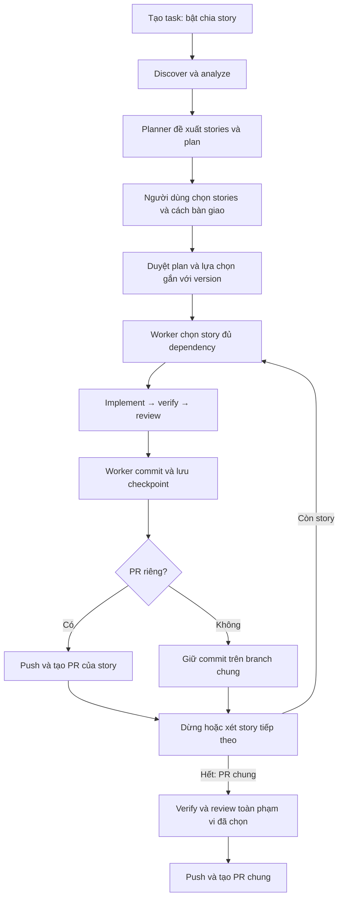

# Story picker và delivery theo story

Trạng thái: người dùng duyệt ngày 2026-10-06; triển khai theo plan cùng ngày.

## Mục tiêu và quyết định đã thống nhất

Người dùng nhập feature; Harness đề xuất các story có point và dependency để chọn phạm vi thực hiện. Có thể tạo PR riêng từng story hoặc một PR cho toàn bộ stories đã chọn. Các story chạy tuần tự và mặc định dừng sau mỗi story. Có thể bật tự động tiếp tục những story đã chọn. Nếu story sau bị gián đoạn, Harness giữ kết quả đã hoàn thành. Feature này không dự báo token, quota hoặc USD.

Phần mở rộng của `2026-09-23-agent-harness-design.md` giữ nguyên các điều kiện về plan approval, test, review, worktree, reconciliation và delivery. Các yêu cầu mở rộng chỉ có hiệu lực sau khi được người dùng duyệt.

## Luồng và trách nhiệm

| Thành phần             | Trách nhiệm                                                                                 |
| ---------------------- | ------------------------------------------------------------------------------------------- |
| Planner                | Đề xuất story có kết quả độc lập, point và mapping vào plan; không tự chọn thay người dùng  |
| UI/API                 | Hiển thị lựa chọn, dependency, point; gửi lựa chọn có version/revision                      |
| Worker                 | Kiểm tra lựa chọn, dependency, approval; chạy tuần tự, lưu checkpoint và điều phối delivery |
| Implement/repair agent | Chỉ sửa phạm vi story hiện hành hoặc finding của lượt tổng hợp                              |
| Runner/reviewer        | Chứng minh từng story và kiểm tra lại snapshot cuối của feature chung PR                    |
| Delivery               | Commit/push/PR có intent và xác nhận; retry không tạo trùng                                 |

## Tương thích và kích hoạt

Input tạo task có thêm `splitIntoStories?: boolean`. Nếu trường này thiếu hoặc có giá trị false, task giữ luồng hiện tại. Khi giá trị là true, planner trả trường `stories` trong PlanVersion. Các task và plan cũ vẫn parse được, không tự chuyển thành feature.

Task gốc điều phối feature. Khi chọn PR riêng, Harness tạo task con cho từng story đã chọn. Khi chọn PR chung, task gốc thực thi từng story trên cùng worktree và branch. UI của task gốc hiển thị tiến độ feature và liên kết tới task con nếu có.

## Contract và validation

`Story` gồm `id`, `title`, `outcome`, `points: 1 | 2 | 3 | 5 | 8`, `dependsOn: string[]`, `criterionIds: string[]`, `stepIds: string[]`. Check và screenshot được lấy từ mapping criterion/check trong plan; không lưu bản sao command có thể lệch với plan.

Mỗi story phải tham chiếu criterion và step tồn tại trong plan. Mỗi criterion và step của plan chia story phải thuộc đúng một story. Nếu step phụ thuộc step của story khác, hai story phải có dependency tương ứng. Một check có thể phục vụ nhiều story và phải chạy lại theo snapshot hiện hành. Chỉ chọn screenshot khi story hoặc lượt verify tổng hợp bao gồm đủ các criterion liên quan.

Validation từ chối ID trùng, dependency không tồn tại, story phụ thuộc chính nó, cycle, mapping thiếu hoặc trùng, lựa chọn rỗng và lựa chọn chứa ID không tồn tại. UI khuyến nghị tách story 8 point; Harness không tự chia bằng heuristic và vẫn cho phép chọn story 8 point.

`StorySelection` gồm `planVersion`, `storyIds`, `mode: separate_pr | shared_pr`, `continueAutomatically: boolean` (mặc định false). Khi chọn một story, phải chọn toàn bộ story mà nó phụ thuộc. UI hiển thị story còn thiếu; server kiểm tra lại lựa chọn. Worker thực thi theo topological order; nếu có nhiều story cùng đủ điều kiện, dùng thứ tự planner đề xuất. Story point không dùng để suy ra phần trăm usage.

Selection được gửi trong command approve và lưu trong cùng transaction với approval. Mode và phạm vi story bị khóa sau khi bắt đầu implement. Replan trước implement làm mất hiệu lực selection và approval; người dùng phải chọn và duyệt version mới. Replan trong lúc thực thi giữ checkpoint, worktree và repair count. Harness chặn thay đổi phạm vi story đã hoàn thành cho đến khi người dùng quyết định tạo task thay đổi riêng. Checkpoint không bị tự xóa.

## Lưu trạng thái và evidence

Thêm record `story-run` với khóa `featureId:planVersion:storyId`. Record gồm state `pending | running | completed | interrupted | blocked`, childTaskId nếu có, baselineCommit, commit, checkpointPath và timestamp. Trạng thái hiển thị phải có evidence thực tế, không chỉ dựa trên lời agent.

Checkpoint JSON chứa story ID, plan version/hash, baseline và commit, fingerprint, tham chiếu check/review và kết quả delivery nếu có. Harness lưu file trước, rồi lưu record xác nhận. Khi recovery, Harness đối chiếu HEAD và effect marker trước retry. Story chỉ chuyển sang completed sau khi test và review pass, commit được xác nhận. Với PR riêng, delivery qua PR hoặc local cũng phải được xác nhận. Với PR chung, story completed chỉ đánh dấu hoàn thành phần việc local; UI phải ghi rõ feature chưa bàn giao.

Evidence và attempt mới có storyId (nullable cho task cũ hoặc lượt tổng hợp), planVersion và baseline. Harness giữ record lịch sử theo story. Luồng stage vẫn có thể dùng record checks/review hiện hành, nhưng phải đối chiếu storyId trước khi chuyển stage. Task detail trả danh sách story và checkpoint đã xác nhận.

## PR riêng từng story

Worker tạo và liên kết task con theo feature/version/story; lặp lại thao tác không tạo thêm task con. Task con giữ pipeline đầy đủ và plan approval. Plan con được tạo từ mapping đã duyệt, không gọi planner để tự thay requirement. Nếu source commit thay đổi sau khi dependency được tích hợp, task chạy discover/plan và duyệt lại theo pipeline hiện tại.

Dependency GitHub chỉ được đáp ứng khi commit của story trước là ancestor của target branch vừa fetch. Nếu squash hoặc rebase merge khiến quan hệ ancestry không xác nhận được việc tích hợp, task chuyển sang blocked và ghi rõ lý do; người dùng phải duyệt replan trên base mới. PR đã mở chưa đủ để xác nhận dependency đã tích hợp. Harness không tự merge PR.

Với local delivery, story phụ thuộc chờ commit có trong target branch của repo đích; người dùng tự tích hợp. Story độc lập không cần chờ merge của story khác. Mặc định dừng sau mỗi task con hoàn thành. `continueAutomatically` chỉ chạy tiếp story đủ dependency, không bypass approval hoặc điều kiện tích hợp.

## Một PR cho toàn feature

Các story dùng worktree và branch của task gốc. Story đầu lấy sourceCommit đã duyệt làm baseline; story sau lấy commit của checkpoint trước. Worker tạo plan thực thi bằng cách lấy phần của story hiện hành từ feature plan, giữ nguyên PlanVersion đã duyệt. Phạm vi, fingerprint và các điều kiện check/review của từng story dùng baseline riêng. Phạm vi cuối dùng baseline của feature và toàn bộ file đã chọn.

Sau test/review pass, commit story rồi chuyển sang story tiếp theo hoặc paused với reason `story_checkpoint`. Không push hoặc tạo PR tại checkpoint. Lịch sử commit/effect dùng storyId và fingerprint để tránh đụng key của delivery cuối.

Sau story cuối, Harness verify toàn bộ required checks của các story đã chọn trên cùng snapshot cuối và review toàn bộ diff so với feature baseline. Nếu có failure, task chuyển sang repair trong phạm vi đã duyệt và giữ lịch sử story. Chỉ deliver khi evidence cuối còn hiệu lực. Báo cáo chung liệt kê từng story, checkpoint và kết quả tổng hợp. Báo cáo story cũ không được dùng làm bằng chứng pass của snapshot cuối.

Repair count của task gốc không reset khi đổi story hay replan. Theo cập nhật đã duyệt ngày 2026-10-07, task con PR riêng có repair count riêng và không giới hạn số vòng. Retry dùng lại task con hiện có để giữ lịch sử và tránh chạy trùng.

## Pause, resume và lỗi

Pause tại checkpoint không cần ngắt process vì agent đã kết thúc lượt chạy. Pause trong lúc thực hiện story dùng cơ chế stop/reconciliation hiện có. Khi resume, Harness không chạy lại story completed, không mở task ghi thứ hai trong cùng worktree và không tạo trùng commit hoặc PR. Quota vẫn có thể hết trước khi story hoàn thành; Harness không tự retry vô hạn khi hết quota.

Task gốc ở mode separate_pr chuyển sang completed khi mọi story đã chọn có delivery được xác nhận. PR của story cuối có thể được bàn giao trước khi merge, nhưng story tiếp theo chỉ chạy sau khi dependency được tích hợp. Nếu chưa chọn story hoặc chưa thể chạy, UI hiển thị waiting/blocked cùng hành động cần thiết.

## UI

Form tạo task có checkbox chia story. Trang duyệt plan hiển thị checkbox chọn từng story, outcome, point, dependency và tiêu chí. Mode được chọn bằng radio; checkbox tiếp tục tự động mặc định tắt. Nút duyệt bị vô hiệu khi lựa chọn thiếu dependency. Backend vẫn kiểm tra lựa chọn độc lập với UI.

Trang task hiển thị story đang chạy, story đã hoàn thành, checkpoint commit, liên kết task con hoặc PR khi có và lý do chờ dependency. Nút tiếp tục xuất hiện tại ranh giới giữa các story. Story chưa chọn được ghi rõ là ngoài phạm vi lượt chạy. Luồng lựa chọn chính không dùng JSON kỹ thuật.

## Tiêu chí nghiệm thu

1. Task cũ và task không bật split giữ pipeline cũ.
2. Planner tạo stories; validation từ chối cycle/ID/mapping/selection không hợp lệ.
3. Người dùng chọn stories, mode và chính sách tiếp tục; stale approval bị từ chối.
4. PR riêng: đúng một task/branch/delivery mỗi story, dependency chỉ mở sau tích hợp đã xác minh.
5. PR chung: cùng branch, từng story có commit và checkpoint; không PR ở checkpoint; final verify/review toàn phạm vi đã chọn rồi mới PR.
6. Dừng mặc định sau mỗi story; bật tự động vẫn giữ mọi gate.
7. Crash/retry ở commit hoặc PR không tạo trùng; resume không chạy lại story completed.
8. Evidence lỗi hoặc cũ không thể đánh dấu completed; test feature bắt buộc không được bỏ qua.

## Ngoài phạm vi

Không triển khai quota estimator hoặc dashboard usage; không tự merge/deploy, chạy stories song song hay đổi mode trong lúc implement. Việc thêm provider, sửa UI không liên quan và bổ sung hàng loạt legacy test cũng nằm ngoài phạm vi.
